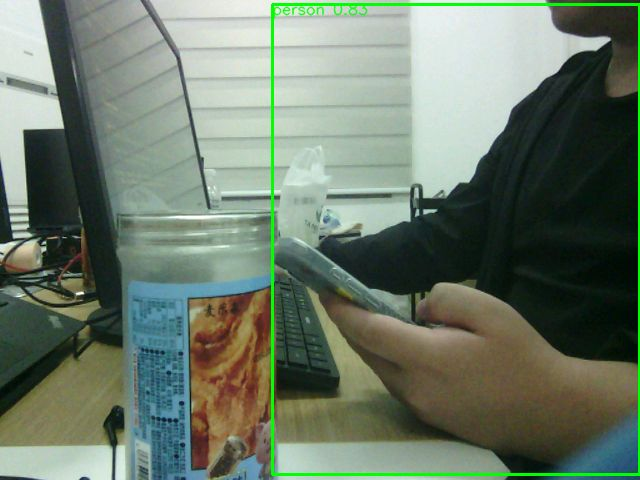

# EdgeMind-Robot

基于 ACG720 FPGA 与 Lichee Pi 4A 的摄像头、激光雷达和差速小车项目。

本地按键选择绕障、原地一圈或视觉任务；4A 提供 NPU 检测和网页预览。
当前功能与验收边界见[项目状态](docs/project-status.md)，维护说明见[文档索引](docs/README.md)。

```powershell
& code/camera-car-control/.venv/Scripts/python.exe -B scripts/check_project.py
```

该命令只检查本地项目、链接和签核记录，不连接开发板。



图像用于展示视频识别界面，不代替当前位流的实屏验收。

## 安装与开发

使用 Python 3.12、WSL 的 Icarus/Verilator 和 Gowin 工具链。
开发环境、测试、构建及签核命令见[开发指南](docs/contributing.md)。
已有的 `code/camera-car-control/.venv/` 是开发环境，不属于历史构建缓存。

## 使用

- 小车按键、三种模式及限制：[模式操作](code/camera-car-control/a745-autonomous/docs/README-MODES-AND-TARGET-74513.md)。
- 4A 视频、NPU 和部署：[视频服务](code/camera-car-control/a745-autonomous/host/README-video.md)。
- IMU、编码器和启动故障：[排障说明](docs/troubleshooting.md)。
- 当前位流与验收依据：[STATUS.json](output/current-firmware/STATUS.json)。

启动运动由本机 S1 完成，网络不提供 ARM 或故障清除。
相机与雷达未完成实物标定，视觉自动接近保持禁用。

## 目录

| 目录 | 内容 |
| --- | --- |
| `code/camera-car-control/a745-autonomous/` | 活动 FPGA 工程、4A 服务和测试 |
| `code/ld06-radar-gui/` | 独立雷达串口诊断工具 |
| `scripts/fpga/` | 烧录、只读采集和签核工具 |
| `model/` | 当前 V5 装配、其必需的 V4 输入及器件模型 |
| `pcb/power/` | 电源/电机驱动板原始设计与元件库 |
| `doc/` | 硬件原始资料、接线和供电预算 |
| `docs/` | 项目说明、开发、状态和维护文档 |
| `output/current-firmware/` | 当前签核、Flash 审计及已记录的实物证据 |

## 参与维护

先读[维护约定](AGENTS.md)与[维护说明](docs/maintenance.md)。
历史交接入口已撤除；以当前状态和相应审计核实版本。
本轮整理的检查和删除计划见[整理记录](output/project-maintenance-20261104/RESULT.json)。

## 许可

项目未声明统一开源许可证。
第三方 RTL、器件资料和模型按各自许可与来源说明使用，原许可文件保留。
