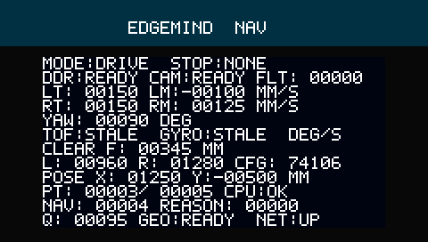

# 任务3/4与RGB屏验证结果

记录时间：2026-10-25T09:48:26.798591+08:00

RTL 55组、Python 61项通过；后端 `wsl:Ubuntu-26.04`；当前输入哈希一致。

用户已于09:44:48要求暂停。另有独立连续突发障碍诊断失败，未计入这55组通过；首要接续问题、从GitHub恢复步骤及失败复现命令见仓库根`HANDOFF-20261025.md`。本报告不能作为连续绕障或实车通过证明。

本轮模式`synth`；完整工具流程：尚未完成，阶段耗时247.6秒；时序尚未签核；未发布运动固件。

时序违例：`{}`；最差裕量ns：`{}`；最小脉宽最差裕量ns：`None`。

已实现LD06净空检测、减速/停车、停车重规划、栅格A*、位姿/局部匹配、起终点与最多16个航点。PicoRV32运行RV32I裸机程序，外部计算机仅设置和观察任务。

联动仿真覆盖实际软核、核心仲裁、合成房间定位、A*及跟踪器的三个邻近航点，并验证过期外部TTL及任务执行时拒绝改图。单独避障仿真覆盖障碍暂停、重规划和恢复。它们均不代表实车已跑通。

同一软核导航夹具中并行运行合成DVP摄像头、DDR帧缓存、HDMI像素链、网口视频和TFT参数屏；校验像素顺序以及任务期间仍有显示/视频进展。DDR专项覆盖连续令牌下最后写入完成后才处理END；FIFO专项覆盖8/4096项容量、回绕、背压和带未读数据复位。

修复了压缩路径负方向的符号扩展，以及上一段到达状态取消下一段的问题；增加反向路径和实际软核导航联动回归。

保留原OV5640、DDR3、HDMI、网口视频与原接线；新增J1/FPC 4.3寸RGB参数页。画面如下，使用仿真数值，非实物照片。

视频内部计数器按跳帧数及图像像素/数据块范围缩窄，超长采集帧的计数饱和为无效值；视频功能和接口保留。回归同时覆盖原DDR背压、坏帧丢弃和双缓冲保护夹具。

CAD推导前/后/半宽为221/70/131mm，旋转半径257mm，雷达前偏164mm。运动学继续采用用户实测234mm轮距；实车外廓与精确扫描高度未验收。

管脚冲突0项；综合器资源原始字段：`{"name": "a741_top", "Register": "46", "Lut": "51", "T_Register": "27236(46)", "T_Alu": "5241(0)", "T_Lut": "35218(51)", "T_MULTALU27X18": "18(0)", "T_MULT12X12": "16(0)", "T_MULT27X36": "25(0)", "T_MULTADDALU12X12": "1(0)", "T_Bsram": "81(0)"}`。

未烧录、未ARM、未驱动电机，未验证屏幕实物或真正断电重启。原130843归档在本机缺失，未覆盖或重新冒称原基线。

固化入口为仓库scripts/fpga/program_flash.py。交付条件通过并关闭电机VM后，显式指定完整位流和SHA，执行外部Flash操作54、校验、Reprogram和状态读取，再实际断电验证。地图/标定/任务仍需按运行时机制恢复。

详细源文件身份、测试清单、几何、管脚和工具证据见TASK3-4-RESULTS.json；实现和使用方式见../docs/TASK3-4.md。
