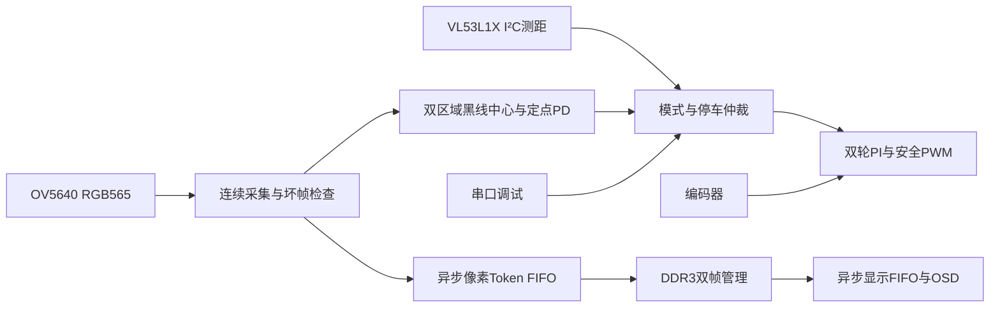

# ACG720 摄像头循线与 ToF 避障停车

2026-10-18：新增独立纯 RTL 工程。**当前交付为可仿真的控制、视频与传感器逻辑，尚无完整板级位流，未下载或操作电机。** 原厂 DDR3/PLL/TMDS/摄像头初始化依赖和 ToF 引脚尚缺；构建入口会明确拒绝缺失依赖，不生成猜测引脚的配置。

## 已实现的功能与架构



- 摄像头：800×480 RGB565，高字节在前，VSYNC 高为帧消隐。每帧检查行宽、行数、总像素及字节配对；前十帧不提供有效循线结果。坏帧和 FIFO 溢出帧不发布到显示区。
- 循线：浅色哑光地面、20～30 mm 黑胶带、直线和缓弯。默认近区 y=360～399，远区 y=260～299，x 为整幅图像。灰度近似 `(R+2G+B)/4`，阈值 80；每区至少 16 个黑点、最多占区域一半，否则该区无效。区域中心用多周期整数除法计算。
- 转向：近处中心偏差和远近中心差，Q8 增益默认 64/96。图像线偏右时左轮加速、右轮减速；可配镜像。正常基础速度 100 mm/s，单区有效或明显偏线时降至最多 40 mm/s；每轮前向目标 0～150 mm/s。两区都无效立即撤销目标，持续 100 ms 锁存停车；视觉数据超过 150 ms 未更新也停车。
- 运动：复用原工程的编码器、测速、PI、差速与旋转模块，新建独立控制核心；不改旧 RTL。左编码器正常、右编码器反相，前进反馈均为正；右桥在 PI **之后**反相。PWM=1 kHz、控制=100 Hz、输出最大 512/1024、默认斜坡 50 mm/s/10 ms。幅值/方向周期锁存，换向至少一周期双低。非法 AB 只统计、不立即停车，保持 A722 策略；无反馈 200 ms 或持续反向反馈约 200 ms 停车。
- ToF：7 位地址 `0x29`（线上写地址 `0x52`），16 位寄存器地址、多字节大端。独立开漏 I²C，支持 repeated START、ACK/NACK、时钟拉伸和有界超时。实现 ST 初始化表、初次校准、长距模式默认配置、33 ms 预算、50 ms 周期（按器件振荡器校准值换算），轮询并清中断。原始 range status=9 映射为有效；其他状态和零距离均无效。
- 停车：前沿净空不大于 250 mm 立即禁止输出并锁存；250～500 mm 基础速度线性为 40～100 mm/s；距离无效或有效数据过期 150 ms 禁止运动。停车后必须人工启动，且连续三次有效净空大于 400 mm、黑线有效、视频就绪、无电机故障。阈值是待实车标定默认值。
- 模式：手动模式保留最高 1000 ms 的命令 TTL，默认 250 ms；自主模式独立运行，不依赖 PC 心跳。STOP/S0、模式切换、障碍和传感器失效可禁止输出。STOP 为 AT8236 `00` 滑行，不等于机械瞬停。
- 显示：每帧 768000 字节，DDR 用户端口每次 128 bit（8 像素），地址单位为 x16 word，步长 8。帧区基址 0 和 `0x0100000`；只在完整帧写命令及数据均接受后发布。显示消隐时排空旧读、跨域清 FIFO、完成确认后切换。坏帧丢弃，等待显示时可丢弃新帧。欠载显示紫色诊断底色，下一帧恢复；OSD 显示识别区、中心、MODE/DIST/LSPD/RSPD/STOP，数值为十六进制，速度为有符号 16 位补码。

## 运行仿真和调试界面

从仓库根目录执行；Python 入口须使用实际 Python 3，Windows 推荐 `-X utf8 -B`。

```powershell
python -X utf8 -B code/fpga/acg720-vision-motion/tests/run_tests.py --iverilog <iverilog.exe路径> --vvp <vvp.exe路径>
python -X utf8 -B -m unittest discover -s code/fpga/acg720-vision-motion/tests -p 'test_*.py' -v
python -X utf8 -B -m unittest discover -s code/fpga/acg720-motion-control/tests -p 'test_*.py' -v
python -X utf8 -B -m unittest discover -s code/fpga/tests -v
python code/fpga/acg720-motion-control/host/car_control_gui.py
```

本次测试工具位于仓库忽略目录 `tmp/vision-motion-tools/bin/`，是 FPGAwars 预编译 Icarus 10.2，未修改系统 PATH；该目录不随 Git 分发。测试入口兼容 PATH 中的 Icarus，或环境变量 `IVERILOG`/`VVP`。日志及源文件哈希输出 `.local/tests/`；已完成验证记录见 [VALIDATION.md](VALIDATION.md)。

图形界面连接时先停止/零限幅，再查询能力。新固件自动关闭旧右轮补偿并把默认轮速设为 100 mm/s；旧固件保留用户原补偿设置。新固件手动轮速不能超过 150 mm/s。循线启动不自动清故障；障碍、丢线停机后可在条件恢复时再次按“启动循线”。故障清除继续通过既有 CLI，或在故障原因排除后复位。程序关闭/断开会尝试停车，意外拔掉 PC 时自主任务继续，手动任务依赖 TTL 停止。

新增 CLI 可独立查询、修改静止参数和启动：

```powershell
python code/fpga/acg720-motion-control/host/vision_control.py --port COM4 sense
python code/fpga/acg720-motion-control/host/vision_control.py --port COM4 set-line-param 0 80
python code/fpga/acg720-motion-control/host/vision_control.py --port COM4 start-line
python code/fpga/acg720-motion-control/host/vision_control.py --port COM4 stop
```

`start-line` 明确启动自主运动，成功后关闭串口会继续运行；`sense` 只读，`set-line-param` 先停止。本文命令在完整位流补齐并通过架空检查后使用，不是当前板上已有能力。

## 板级依赖与接线

平台集成契约见 [PLATFORM.md](PLATFORM.md)，约束审查见 [constraints/README.md](constraints/README.md)，串口和参数见 [PROTOCOL.md](PROTOCOL.md)。

| 信号 | 现有 FPGA 球号 |
|---|---|
| 50 MHz / S0 | Y18 / F15 |
| UART RX/TX | J21 / M15 |
| 左 IN1/IN2、编码器 A/B | A18/A19、A15/A16 |
| 右 IN1/IN2、编码器 A/B | F13/F14、E13/E14 |
| 相机 RESET/SCL/SDA | C14/B13/D15 |
| 相机 PCLK/HREF/VSYNC | B18/D14/C13 |
| 相机 D0..D7 | C15/B15/B16/D17/C17/E16/D16/B17 |
| ToF SDA/SCL/XSHUT | **待确认，禁止按此表猜球号** |

球号不是排针针号。ToF 模块供电、SDA/SCL 上拉及 XSHUT 电平须按成品模块复核；不能直接套用裸芯片供电。XSHUT 只拉低或释放，模块未引出时可保持外部上拉，但平台需明确是否真的连接。摄像头斜向前下方固定，使近远两区看到地面黑线；ToF 正前向安装。测量 ToF 到车体最前沿的后退距离，写入 `front_offset_mm`；净空为 `max(distance-offset,0)`。

```powershell
# 缺少依赖时返回 2；不会生成工程或调用下载器。
python -X utf8 -B code/fpga/acg720-vision-motion/scripts/build.py check
# 依赖齐备后按 PLATFORM.md 准备 .local/platform/manifest.json。
python -X utf8 -B code/fpga/acg720-vision-motion/scripts/build.py prepare
python -X utf8 -B code/fpga/acg720-vision-motion/scripts/build.py build --gowin C:/Gowin/Gowin_V1.9.12.04_x64/IDE/bin/gw_sh.exe
```

## 实板验收顺序

1. 补齐平台源码，核对所有 CST、Bank、时钟与 reset；构建并逐项审查 P&R 管脚及 setup/hold/recovery 和 CDC，不把工具返回 0 当成签核。
2. 电机架空：静止上电无输出；手转前进计数均为正；限幅短动作核对两轮驱动和反馈符号、STOP、失联、无反馈和换向。新固件不再使用主机右轮反相。
3. 固定相机标定视野和灰度阈值，验证直线/缓弯、遮挡/丢线/停钟；ToF 用 200/300/500/700 mm 等已知距离验证状态、安装偏移、无目标和拔线行为。有效测距不可用时本版选择停车。
4. 100 mm/s 起步，在固定浅色黑线场地连续三圈；静态正前障碍十次停车不接触且剩余净空至少 100 mm。若不满足，降低速度并扩大停车阈值后重新验收。移障不自行恢复，人工重启正常。
5. 实景 HDMI 连续运行至少 30 分钟，检查图像刷新、撕裂、欠载、错误灯及控制；记录视频、停止距离、构建哈希和实际参数。首轮只 SRAM 下载，未实测前不写 Flash。

以上为待执行验收，不是已完成结果；单颗前向 ToF 只覆盖其视野，首版不进行自主倒车、主动绕障或复杂路径规划。
