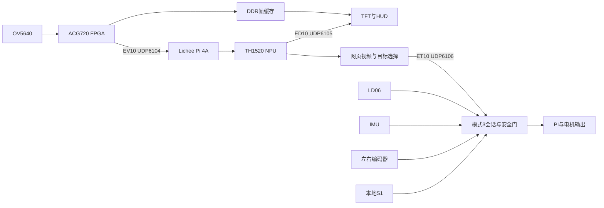

# 系统架构

FPGA处理摄像头采集、DDR帧缓存、本机TFT显示和电机安全控制。
4A处理视频接收、NPU目标检测、网页预览和受限视觉任务。

## 模块边界

`rtl/a745_top.v`连接视频、跨域、RGMII和显示。
`rtl/a745_core.v`连接本地模式、监督CPU、传感器、导航和执行器。
`rtl/a745_motion_planner.v`执行模式任务，路径检查由独立几何模块约束。
`host/fpga_video_yolo_web.py`管理网页和推理，`host/vision_task.py`形成有期限的任务段。

ED10提供显示元数据，最多八个框；本机画面叠加最新推理结果，存在推理时延。
ET10属于可影响电机的接收通道，要求本地模式3与S1建立的会话。
网络不提供ARM、故障清除或无限续约。
原始RX并非整体与电机隔离，共享流控及诊断可能通过新鲜度检查造成停车。

## 源码与生成物

可编辑RTL、固件、约束、原厂IP和配置保留在活动工程。
构建器在 `.local/platform/` 生成明确的板级副本，记录原始来源和输入哈希。
当前主构建在 `.local/gowin-a745-autonomous/`，是STA/SDF审核的数据源。
审核程序集中在 `scripts/fpga/validation/`，结果集中在 `output/current-firmware/`。
生成物用哈希索引引用，避免再复制整套SDF和网表。

机械设计的V5依赖同级V4五个基础输入，因此V4目录仍属于当前设计依赖。
其与导航几何的关系见[机械说明](../model/chassis/README.md)。
