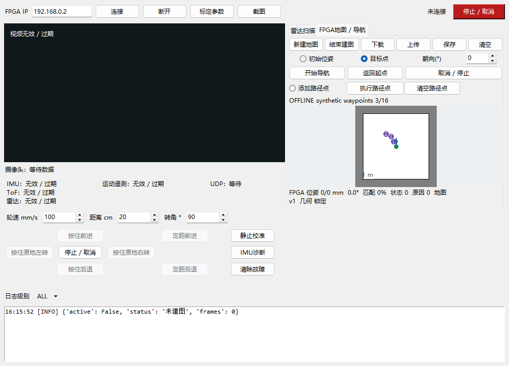

# 任务3/4阶段记录（2026-10-24）

**最新状态：用户要求暂停并打包交接，所有编译与测试已停止。后续以[AI交接说明](AI-HANDOFF-20261024.md)为准。最后完整回归48组RTL/61项Python，最新改动后的49组全量回归与综合被人工停止，不能混用较早结果。未烧录或运动。**

这是当前开发阶段的检查点，不是实车验收或固件发布记录。最终结果以工具结束后生成的 TASK3-4-REPORT.md / TASK3-4-RESULTS.json 为准。

已完成代码和离线验证

- FPGA 内计算 LD06 车体净距、限速、停车、有限停车重规划、定位、栅格 A* 和跟踪。
- PicoRV32 运行 RV32I 裸机 C 程序，顺序管理最多16个航点；PC用于设置与观察，明确启动后提供板内租期。
- 使用完整V4/V5装配核对CAD参数，前/后/半宽221/70/131mm，旋转半径257mm，雷达前偏164mm。保留用户实测234mm运动学轮距；实物几何未验收。
- 保留原OV5640、DDR3、HDMI、网口视频及接线，新增用户确认的J1/FPC 4.3寸480×272 RGB参数屏；21个屏幕管脚无重复分配。
- 修复压缩路径负方向符号扩展、前段到达标志干扰下一段，以及任务正常结束误记外部TTL故障。正常释放自主权优先结束ARM会话，真正的租期丢失仍锁存停车。
- 上轮完整回归46组RTL、61项Python通过；后续时序改动正在重跑完整回归，不能混用较早哈希。大CAD场景分别用Icarus和Verilator通过；完整WSL回归为该场景选择Verilator，并记录每组后端。
- 固化脚本的9项离线测试通过；预览不会调用Programmer，校验失败不会继续重载，也不会降级SRAM下载。

当前构建

2026-10-24 18:22（北京时间）启动的完整合并构建在约19:09主动停止，耗时2788.6秒，停在路由阶段，没有最终时序报告或可交付位流。停止后发现综合估算中，前净距到跟踪器限速寄存器之间存在65级组合逻辑，50MHz目标下估算仅18.350MHz，原因是串联的宽乘除法；这不是已完成的布局布线时序结果。用户随后要求暂停，所有构建均已停止。

恢复后将两处限速算式改成定宽流水计算，默认距离缩放100/350约分为2/7，跟踪器3/5计算单独分级。硬停车通路保持立即响应。逐毫米限速、全部1024种速度输入、路径跟踪与屏幕时序定向仿真通过，正在重新进行完整回归和仅综合检查；检查具体关键路径后再启动布局布线。MAC FIFO约束继续保持定向范围，未切断整个时钟组。

前两轮综合估算依次为30.733MHz（42级，跟踪器取绝对值/轮距乘法）和37.386MHz（36级，位姿门控到安全限速再到跟踪器）。已分别拆分转向算式，并让安全判断使用门控前的目标轮速、跟踪器使用寄存后的上限。导航模块单独综合估算从45.746提升到64.637MHz；单模块不是整板时序证据。已启动新的整板综合，未进入新的布局布线。结果中自动保存综合时钟表、关键路径与报告哈希。

构建目录为 `.local/gowin-fusion-tft480`。`result.json`记录运行状态、PID、起始时间和输入哈希；运行中的记录不能用作验收通过。此前开发尝试的日志分别保留在 `.local/interrupted-tft480-20261024-155258`、`.local/routing-route2-20261024-173740`和`.local/routing-stopped-20261024-1909`，均无完成位流，不是发布版本。

尚未完成

整板时序签核、完整录制传感器回放、实际屏幕/相机并行验证、实车定位与制动/绕障/航点精度、外部Flash写入校验和真正断电重启均未验收。本轮没有烧录、ARM或驱动电机。

原130843归档在本机缺失，未覆盖或重新冒称原基线。交付条件通过后，关闭电机VM并使用仓库 `scripts/fpga/program_flash.py` 显式指定完整位流及SHA，执行外部Flash操作54、校验和Reprogram；实际断电还须排除反向供电。Flash保存逻辑和软核初始化程序，运行时地图、标定和路径点需要按各自机制恢复，不自动恢复运动任务。
