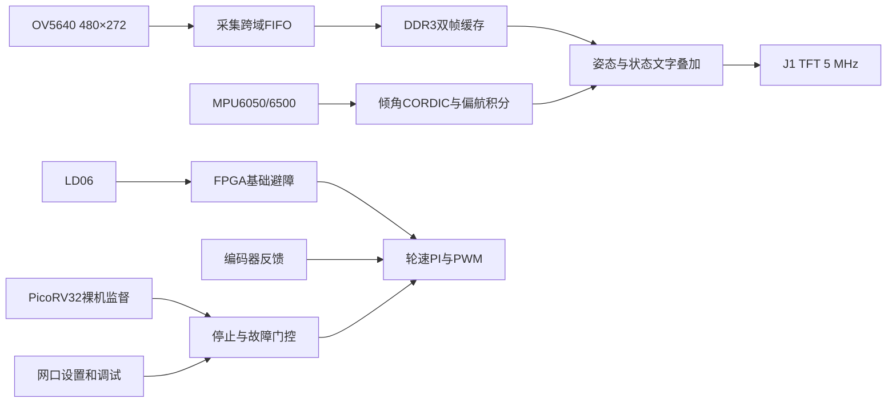

# 基础系统结构

文件名中的fusion是旧入口名称，当前没有完整导航分支。

`a741_video` 保留摄像头域、DDR UI域、50 MHz显示消费域的FIFO和帧切换握手。TFT在50 MHz域用像素使能推进；输出PCLK不是内部逻辑时钟。`a741_osd`双缓冲完成文字转换后仅在帧空白发布。

`a741_core`组装传感器、裸机监督、基础避障、原始轮速调试保护、motion与UDP。`a741_motion`直接接网络命令，不再实例化控制UART；保留校准、编码器、PI、原子目标、租期和最终输出门控。旧转角/航向算术已移除，兼容状态中rotating/relative固定0。

`a741_avoidance`拥有目标时，手动轮速不能抢占；释放所有权即结束ARM会话。有效雷达恢复可解除避障受阻停车，失联/CPU/电机故障/掉ARM则退出任务且不能自动恢复。停止优先于计算结果发布。

详见 [README](../README.md) 与 [协议](FUSION-PROTOCOL.md)。所有物理接口与板级时序验收仍独立。
